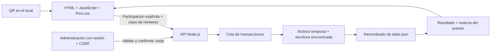
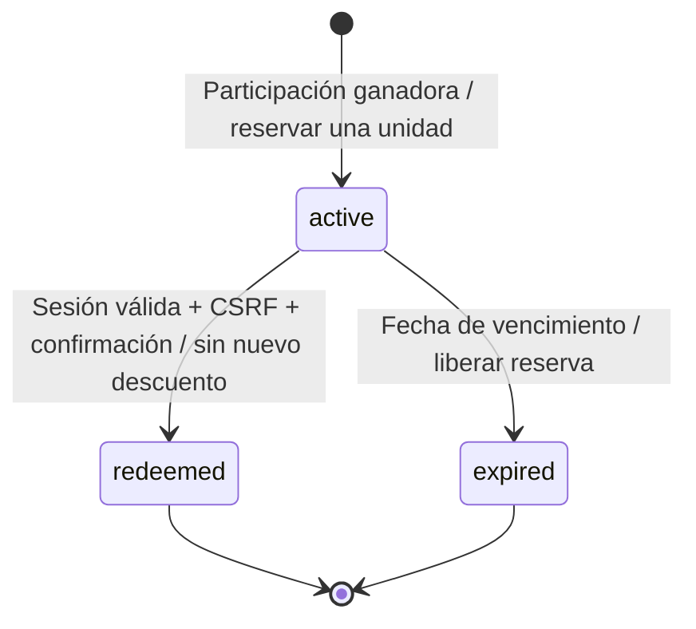

# Una interfaz liviana y una única autoridad para los premios

El navegador presenta la experiencia. El servidor decide el orden, el premio, la reserva y el canje. Los archivos de datos nunca se sirven por HTTP.

La PWA agrega manifiesto, iconos, instalación guiada y un service worker limitado a recursos públicos. Las navegaciones no se guardan; API, cupones, QR privados y documentos administrativos no entran en Cache Storage. Sin conexión se ofrece una pantalla informativa, no un motor de premios local.

## Recorrido principal



## Estructura

```text
premio/
├── index.html                 Experiencia pública
├── admin.html                 Panel y acceso administrativo
├── cupon.html                 Consulta privada del cupón
├── cartel.html                Cartel QR imprimible
├── assets/
│   ├── css/                   Tokens, experiencia, panel e impresión
│   ├── js/                    Módulos de interfaz, HTTP y utilidades
│   ├── icons/                 Iconos SVG externos
│   └── images/                Ilustraciones originales de esta versión
├── img/                       Imágenes proporcionadas por el usuario
├── config/prizes.json         Catálogo editable en código, no en una BD
├── server/
│   ├── index.js               Arranque y configuración del proceso
│   ├── app.js                 HTTP, rutas, archivos públicos y cabeceras
│   ├── auth.js                Contraseñas, sesiones, cookies y límites
│   ├── game.js                Reglas, stock, cupones y administración
│   ├── store.js               Persistencia y exclusión de escritores
│   └── errors.js              Errores públicos uniformes
├── scripts/                   Configuración y verificaciones
├── tests/api.test.js          Tests contra el servidor real
├── data/                      Estado privado generado, excluido de Git
├── docs/                      Guías y contrato OpenAPI
├── artifacts/                 Capturas y resultados locales, no versionados
├── .env                       Secretos locales, nunca públicos
└── laidea.md                  Fuente original conservada
```

## Consistencia del archivo

1. Un bloqueo exclusivo evita que dos procesos utilicen la misma carpeta de datos.
2. Una cola serializa las operaciones de ese proceso.
3. Cada operación trabaja sobre una copia del estado.
4. Solo después de una escritura completa y el renombrado se confirma la copia en memoria.
5. Una excepción no modifica el estado anterior ni en memoria ni en disco.

Esto evita ganadores duplicados por concurrencia dentro de la instalación. No reemplaza una base de datos distribuida ni un sistema de copias de seguridad. Si el archivo está corrupto, el arranque falla: no se reinicia el contador silenciosamente.

## Reintentos sin premios duplicados

El cliente crea una `Idempotency-Key` antes de participar y la conserva hasta recibir una respuesta aceptada. El servidor la asocia con la cookie del navegador y devuelve el resultado original si se repite. Se comprueba antes del límite de 24 horas, de la pausa y del stock.

Si el navegador bloquea `sessionStorage`, la clave se conserva en memoria mientras la pestaña siga abierta. Borrar datos del navegador también elimina esta capacidad de recuperación.

## Ciclo de vida del cupón



La caducidad se procesa al consultar o modificar el estado. No depende de un temporizador de la pestaña. Todos los tiempos se guardan en ISO/UTC y se presentan en hora de Chile.

## Actualización automática del panel

El panel consulta el contrato existente `GET /api/admin/dashboard` cada tres segundos mientras la pestaña es visible. También consulta inmediatamente al recuperar el foco o la conexión. Entre pestañas del mismo origen, `BroadcastChannel` avisa de una participación confirmada; el aviso no contiene cupones ni datos personales y nunca modifica contadores por su cuenta: la información se vuelve a consultar al servidor.

Las consultas no se superponen, se pausan en segundo plano y se detienen al cerrar sesión. Ante problemas de red se conserva la última vista y se amplía la espera de reintento; los límites del servidor respetan su fecha de recuperación. El renderizado selectivo conserva filtros, campos enfocados y cambios de configuración o stock todavía no guardados.

Este mecanismo ofrece actualización automática con una demora normal máxima aproximada de tres segundos para otros dispositivos; no se presenta como una conexión de eventos instantánea entre servidores.

## Cuándo cambiar la arquitectura de almacenamiento

La entrega de producción incluye una instancia Node no privilegiada detrás de Caddy, con backend interno, disco persistente y servicio de mantenimiento sin red. Consulte [Producción](PRODUCCION.md) para configuración y respaldos consistentes. Docker, TLS y red pública todavía deben validarse en el destino.

Migrar a una base de datos transaccional antes de usar múltiples instancias, almacenamiento efímero, varias sucursales o una carga que vuelva costosa la reescritura del JSON. La interfaz y el contrato HTTP pueden mantenerse; cambia la implementación de persistencia.
